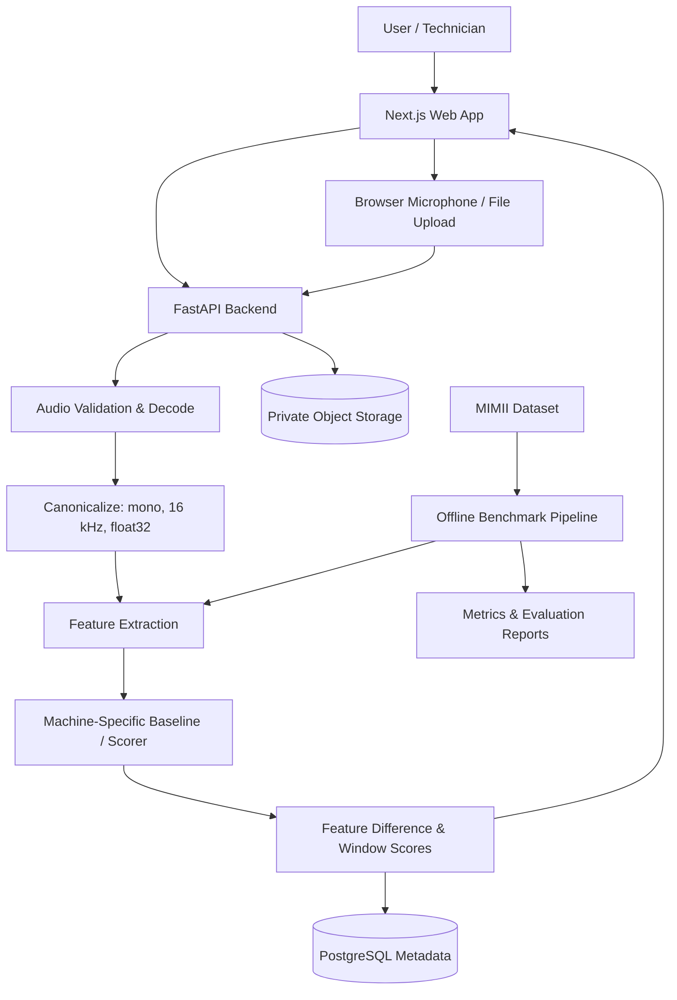

# Stetho — Product Requirements, ML Design & Delivery Plan

**Event:** Kiroween 2026  
**Target category:** Frankenstein  
**Product type:** Machine-specific acoustic anomaly monitoring and inspection assistant  
**Owner:** Solo developer  
**Document status:** Build specification / living project plan  
**Created:** 30 October 2026  
**Target submission deadline:** 4 December 2026, 2:00 PM Pacific Time (5 December 2026, 3:30 AM IST)  
**Primary repository name:** `stetho`  
**Primary demo machine:** Small electric fan  
**Benchmark dataset:** MIMII Dataset (Hitachi)  

> **Product promise:** Stetho learns the normal acoustic signature of a specific machine under a recorded operating condition, compares new recordings against that baseline, and presents an evidence-backed anomaly score with clear limitations and an inspection report.

---

## 1. Executive Summary

Stetho is an acoustic condition-monitoring prototype for small workshops, laboratories and maintenance teams. A user creates a profile for one physical machine, records several examples of its normal operation, and lets Stetho build a machine-specific acoustic baseline. Later recordings are analyzed against that baseline. The application highlights measurable differences in acoustic features, shows the waveform and spectrogram, assigns an anomaly score, and creates a maintenance-inspection report.

Stetho is **not** a universal machine-fault classifier. It does not claim that a particular sound proves a bearing failure, leakage, imbalance or any other root cause. Its primary job is to identify recordings that differ from a defined baseline and help a person decide whether inspection is warranted.

The core workflow is:

1. A user creates a machine profile and records its operating context (machine type, operating mode, microphone position and environment).
2. The user records or uploads multiple examples of normal operation.
3. Stetho validates the audio and checks for clipping, silence, duration and signal-quality problems.
4. The feature pipeline converts each recording to a canonical audio format and extracts time- and frequency-domain features.
5. A machine-specific baseline model is fitted using normal recordings only.
6. The user records or uploads a new sample from the same machine under comparable conditions.
7. Stetho compares it with that machine's baseline and displays an anomaly score, a result category, and the features that changed most.
8. The user reviews an inspection checklist and exports a report.

The project will use the MIMII Dataset for reproducible benchmark evaluation and separately record a real fan for the end-to-end product demonstration. These two evidence tracks must not be confused: public benchmark results do not prove that the same detector generalizes to every real machine, room, microphone or operating mode.

### 1.1 One-sentence pitch

**Stetho gives small maintenance teams a practical acoustic baseline for each machine, so they can spot unusual operating sounds early and inspect the machine before assuming what is wrong.**

### 1.2 Target users

- Small workshop owners who do not have a dedicated condition-monitoring system.
- College engineering laboratories maintaining fans, pumps and other small equipment.
- Maintenance technicians who want a repeatable way to compare a machine's sound over time.
- Demonstrators and educators teaching acoustic signal processing and anomaly detection.

### 1.3 Positioning and originality

Acoustic machine anomaly detection is an established research and industrial field. The MIMII Dataset, DCASE challenge tasks and published baseline systems already demonstrate this problem and several solution families. Stetho must not claim to invent acoustic anomaly detection or to be the first machine-listening system.

Stetho's hackathon contribution is a focused, usable workflow for **machine-specific baseline enrollment**:

**record a particular machine → learn its normal acoustic profile → compare later recordings under similar conditions → explain measurable changes → support a human inspection decision.**

The product differentiators are:

- A guided baseline-enrollment workflow for one physical machine, not only a pre-trained generic classifier.
- Explicit capture-context records: operating mode, microphone placement, distance and environment.
- Signal-quality checks before interpreting an audio sample.
- Side-by-side waveform and spectrogram comparison.
- Explanations grounded in measured feature changes, not invented mechanical diagnoses.
- A transparent benchmark report using MIMII with strict train/test separation.
- A repeatable maintenance inspection report that links back to the source recording and baseline.

Do not describe this as a certified predictive-maintenance product. It is a hackathon prototype for acoustic anomaly screening.

---

## 2. Product Goals, Non-Goals and Success Measures

### 2.1 Goals

| ID | Goal | Success measure |
|---|---|---|
| G-01 | Create a machine-specific acoustic profile | A user can create a machine profile with operating and recording metadata |
| G-02 | Enroll normal operating audio | A baseline is created from validated normal recordings only |
| G-03 | Analyze a new recording | An analysis run returns a numeric anomaly score and an interpretable result |
| G-04 | Explain observed differences | The report identifies the measured features that differ most from baseline |
| G-05 | Visualize audio | The UI displays a waveform and a log-mel spectrogram for baseline and test recordings |
| G-06 | Benchmark the detector | MIMII evaluation reports ROC-AUC and low-FPR partial AUC with per-machine results |
| G-07 | Support a real-device demo | A recorded fan can be enrolled and a changed recording can be compared end-to-end |
| G-08 | Preserve evidence and traceability | Every result links to a recording, profile, baseline version and model version |
| G-09 | Use Kiro meaningfully | The repository contains specs, steering, hooks and tests; the submission explains actual use |
| G-10 | Avoid overclaiming | UI and documentation explain that anomaly scores are not failure probabilities or fault diagnoses |

### 2.2 Non-goals for the hackathon MVP

Do not build these before the primary workflow works:

- A universal classifier for every motor, pump, fan, gearbox and industrial machine.
- A system that identifies the exact mechanical fault from sound alone.
- A certified safety-monitoring, warranty or predictive-maintenance product.
- Real-time continuous factory monitoring or a fleet-wide IoT platform.
- Hardware sensor integrations, vibration sensors or PLC/SCADA connectivity.
- Automatic shutdown, control or actuation of machinery.
- A large multi-tenant enterprise product with role hierarchies and billing.
- A full mobile native application; responsive web/PWA is sufficient.
- A large deep-learning model as the first milestone.
- Training on anomalous test recordings or leaking test data into preprocessing and threshold tuning.
- Claims of 99% accuracy or guaranteed early-failure prediction without independent evidence.

### 2.3 MVP success measures

| Area | MVP measure |
|---|---|
| Profile setup | A user can create and reopen at least one machine profile |
| Baseline enrollment | At least five valid normal clips can be enrolled; the UI recommends more recordings for a more stable baseline |
| Audio validation | Invalid, silent, clipped or too-short audio is rejected or marked low quality before scoring |
| Inference | A valid new clip produces a result, score and feature-difference view |
| Explainability | Every displayed explanation maps to a computed feature and its baseline comparison |
| Benchmark | A reproducible script reports per-machine ROC-AUC and pAUC on held-out data |
| Traceability | Analysis stores recording ID, profile ID, baseline version, model version and preprocessing version |
| Privacy | Users can delete recordings and profiles; retention behaviour is documented |
| Demo | A complete normal-baseline → changed-recording → report workflow can be shown without depending on a live third-party API |

No minimum AUC is promised before measurement. Establish a baseline, evaluate it honestly, record the result and explain limitations. If a model performs poorly on one machine ID, report that rather than hiding it in an average.

---

## 3. Product Scope and Priorities

### 3.1 Must-have scope (P0)

1. Responsive dashboard and machine profile creation.
2. WAV upload and browser microphone recording.
3. Audio decoding, validation, mono conversion and resampling to a canonical 16 kHz sample rate.
4. Waveform and log-mel spectrogram generation.
5. Feature extraction for each recording.
6. Baseline enrollment from normal recordings for one machine profile.
7. Machine-specific anomaly scoring.
8. Feature-difference explanations with source measurements.
9. Recording and analysis history.
10. MIMII benchmark/evaluation scripts with correct data separation.
11. Report export as JSON and CSV (PDF is not required for MVP).
12. Demo mode with prepared recordings, so judges can test the workflow quickly.
13. Tests, documentation, open-source license and `.kiro` project directory.

### 3.2 Should-have scope (P1)

- Multiple machine profiles.
- Configurable operating-mode and microphone-placement metadata.
- Baseline version history and re-enrollment.
- Comparison of two recordings.
- Inspection checklist and technician notes.
- A small comparison of two anomaly models.
- CSV export of benchmark results.
- Optional English/Hindi interface labels if time permits.

### 3.3 Stretch scope (P2)

- Small convolutional autoencoder using log-mel spectrograms.
- ONNX export for portable inference.
- Optional scheduled monitoring through a separate Kiro Crew app (not part of this primary Stetho submission).
- Additional machine types beyond the fan.
- Batch upload and batch scoring.
- Browser-side audio-quality preview and advanced microphone diagnostics.

### 3.4 Cut line

If the schedule slips, cut features in this order:

1. Hindi interface.
2. ONNX export.
3. Deep-learning autoencoder.
4. Multiple machine types in the public product demo.
5. Batch analysis.

Do **not** cut baseline enrollment, data-leakage controls, test reporting, audio-quality validation, clear score interpretation or the end-to-end demo.

---

## 4. Primary User Journeys

### 4.1 First-time setup and machine profile

1. User opens Stetho.
2. User chooses **Create machine profile**.
3. User enters a name, machine category (initially fan), location/asset label, operating mode and notes.
4. User records or selects microphone placement, distance and device details.
5. Stetho explains that baseline and future recordings should use comparable conditions.
6. User saves the profile.

**Acceptance:** A profile has a unique ID, required metadata and a visible status of `Needs baseline`.

### 4.2 Baseline enrollment

1. User opens the machine profile.
2. Stetho explains how to record the machine safely and consistently.
3. User records or uploads multiple normal-operation clips.
4. Each clip passes audio validation.
5. Stetho extracts features and shows signal-quality details.
6. User confirms that the clips represent normal operation under the same machine mode.
7. Stetho creates a versioned baseline.
8. The profile status changes to `Baseline ready`.

**Acceptance:** The baseline records which clips, preprocessing settings, feature version and model parameters were used. A baseline cannot be trained from clips marked anomalous or from an unreviewed mixed batch.

### 4.3 New recording analysis

1. User selects a machine profile.
2. User records a new sample or uploads a supported audio file.
3. Stetho validates duration, clipping, silence and format.
4. Stetho preprocesses the audio using the same pipeline version as the baseline.
5. The anomaly detector scores the new recording and its time windows.
6. The UI shows the overall anomaly score, status, quality warnings and top feature differences.
7. User can compare the new recording with a baseline example.
8. User adds an optional note and exports the report.

**Acceptance:** The result states `Normal-like`, `Unusual` or `Inconclusive`; it never states a guaranteed fault diagnosis.

### 4.4 History and baseline update

1. User opens a machine's analysis history.
2. User selects two recordings for comparison.
3. Stetho displays their waveform, spectrogram and feature values.
4. User can create a new baseline version only after reviewing the recordings.
5. The old baseline remains accessible for comparison and auditability.

**Acceptance:** Re-enrollment creates a new baseline version; it does not silently overwrite the baseline used by prior analyses.

### 4.5 Judge demo mode

A judge can open the public app and choose a preconfigured fan demo. The demo includes prepared normal and changed recordings, a visible baseline, and an explanation of the dataset and model limits. Judges should not need to create an account or upload a large dataset to see the product work.

---

## 5. Functional Requirements

Priority definitions: **P0** = required for MVP; **P1** = important if time allows; **P2** = stretch.

### 5.1 Machine profiles

| ID | Priority | Requirement | Acceptance criteria |
|---|---|---|---|
| FR-001 | P0 | Create machine profile | User can enter name, machine type, operating mode and notes |
| FR-002 | P0 | View machine profiles | Dashboard lists profiles and baseline status |
| FR-003 | P0 | Edit profile metadata | User can edit safe descriptive fields without altering prior analysis records |
| FR-004 | P1 | Record capture context | Store microphone/device, approximate distance, position and environment notes |
| FR-005 | P1 | Archive/delete profile | User can archive or delete a profile and its associated audio according to retention policy |

### 5.2 Recording and audio ingestion

| ID | Priority | Requirement | Acceptance criteria |
|---|---|---|---|
| FR-006 | P0 | Upload WAV audio | Supported WAV file is accepted and decoded |
| FR-007 | P0 | Record from microphone | Browser requests microphone permission and records audio when supported |
| FR-008 | P0 | Normalize audio | Pipeline converts supported input to mono float waveform at 16 kHz |
| FR-009 | P0 | Validate duration | MVP accepts clips from 3 to 30 seconds; invalid durations receive a clear message |
| FR-010 | P0 | Validate signal quality | Detect silence, severe clipping, invalid samples and decode failures |
| FR-011 | P0 | Display waveform | User sees a waveform preview before analysis |
| FR-012 | P1 | Support additional formats | Add FLAC/MP3/WebM only after decoding tests and server limits are in place |
| FR-013 | P1 | Retake recording | User can discard an unsuitable capture and record again |

### 5.3 Baseline enrollment

| ID | Priority | Requirement | Acceptance criteria |
|---|---|---|---|
| FR-014 | P0 | Enroll normal clips | User can select multiple valid clips for baseline creation |
| FR-015 | P0 | Enforce minimum enrollment | MVP requires at least five valid clips; UI recommends at least ten clips from the same operating condition |
| FR-016 | P0 | Confirm normal state | User explicitly confirms that selected clips represent normal operation |
| FR-017 | P0 | Build machine-specific baseline | Baseline is fitted separately for each machine profile |
| FR-018 | P0 | Version baseline | Store baseline ID, source recording IDs, model version and feature-pipeline version |
| FR-019 | P1 | Baseline quality indicator | Show clip count, total duration, clipping, noise and consistency warnings |
| FR-020 | P1 | Re-enroll baseline | New enrollment creates a new baseline version and preserves old versions |

The five-clip minimum is a product-enrollment guardrail for the prototype, not a statistically proven guarantee of reliable coverage. The interface must still label small baselines as provisional and recommend more normal recordings across the machine's usual operating variation.

### 5.4 Anomaly analysis

| ID | Priority | Requirement | Acceptance criteria |
|---|---|---|---|
| FR-021 | P0 | Analyze against selected baseline | User can analyze a new recording for a machine with a ready baseline |
| FR-022 | P0 | Produce anomaly score | API returns a deterministic score for the same model version and input |
| FR-023 | P0 | Produce understandable status | Result is `Normal-like`, `Unusual` or `Inconclusive` |
| FR-024 | P0 | Explain feature differences | Show the top measured features that differ from baseline |
| FR-025 | P0 | Show quality warnings | Poor-quality or mismatched captures are flagged before conclusions are shown |
| FR-026 | P0 | Show time-localized scores | Plot scores across windows to identify when the recording differs |
| FR-027 | P1 | Compare recordings | Side-by-side waveform, spectrogram and feature comparison |
| FR-028 | P1 | Inspection checklist | Generate generic, non-diagnostic checks for a technician to review |
| FR-029 | P1 | Add operator note | User can record their observation alongside a result |
| FR-030 | P2 | Batch analysis | Analyze a list of recordings against a selected baseline |

### 5.5 Reports and history

| ID | Priority | Requirement | Acceptance criteria |
|---|---|---|---|
| FR-031 | P0 | Save analysis history | Every analysis is linked to machine, recording, baseline and model versions |
| FR-032 | P0 | Export JSON report | Report includes metadata, score, quality warnings, feature differences and limitations |
| FR-033 | P1 | Export CSV measurements | Feature values and per-window scores can be downloaded |
| FR-034 | P1 | History filtering | Filter by machine, date and result status |
| FR-035 | P1 | Compare historical results | Show score trend only when baseline/model versions are compatible or clearly indicate version changes |

### 5.6 Benchmark and evaluation tools

| ID | Priority | Requirement | Acceptance criteria |
|---|---|---|---|
| FR-036 | P0 | Load MIMII dataset metadata | Script discovers machine type, machine ID, condition and file paths |
| FR-037 | P0 | Preserve official splits | Train uses normal-only training files; test uses held-out normal and anomalous files |
| FR-038 | P0 | Prevent leakage | Splitting occurs before window generation; fitted scalers and thresholds use training/validation only |
| FR-039 | P0 | Calculate metrics | Evaluation reports ROC-AUC and low-FPR pAUC, with implementation documented |
| FR-040 | P0 | Report per-machine results | Results are shown by machine type and machine ID, not only one aggregate |
| FR-041 | P1 | Compare model variants | Compare robust feature baseline and Isolation Forest; optionally compare a small autoencoder |
| FR-042 | P1 | Save benchmark metadata | Save random seed, split manifest, config, code version and model artifact reference |

---

## 6. Non-Functional Requirements

| ID | Area | Requirement |
|---|---|---|
| NFR-001 | Performance | A 10-second clip should normally complete analysis within 10 seconds on the configured CPU deployment; measure and report actual p50/p95 |
| NFR-002 | Performance | Audio preprocessing must have bounded memory use and must not load the full MIMII dataset into RAM |
| NFR-003 | Reliability | Repeating analysis with the same input, preprocessing version and model version must yield reproducible results within documented numeric tolerance |
| NFR-004 | Reliability | A failed decode or inference must return a useful error, not a fabricated anomaly score |
| NFR-005 | Reliability | Database writes for recording, baseline and analysis metadata must be transaction-safe |
| NFR-006 | Usability | The main workflow must be understandable without ML knowledge |
| NFR-007 | Accessibility | Dashboard controls must be keyboard accessible, have labels and maintain readable contrast |
| NFR-008 | Privacy | Raw audio is private user data; provide consent, retention information and deletion controls |
| NFR-009 | Security | Validate file type, size, duration and decoded content; never trust the filename or MIME type alone |
| NFR-010 | Security | Do not execute uploaded files or accept arbitrary remote URLs for audio ingestion |
| NFR-011 | Security | Rate-limit public analysis endpoints and protect storage objects from unintended public access |
| NFR-012 | Maintainability | Frontend, API, audio processing and model code have clear module boundaries |
| NFR-013 | Maintainability | All model outputs include model and preprocessing version identifiers |
| NFR-014 | Portability | Local development runs with documented commands and Docker Compose |
| NFR-015 | Observability | API logs include request ID, processing stage and duration, but not raw audio or secrets |
| NFR-016 | Honesty | Scores are labeled anomaly scores, not probabilities of failure or remaining useful life |
| NFR-017 | Compatibility | Support current Chromium-based desktop browsers for the hackathon demo; document microphone permission requirements |
| NFR-018 | Recovery | Users can delete a recording and its derived artifacts under the documented retention policy |

### 6.1 Provisional performance targets

These are engineering targets, not results to advertise before measurement:

- 10-second recording analysis: target p95 under 10 seconds on the demo CPU environment.
- Audio input: 3–30 seconds in the MVP.
- Maximum upload size: initially 15 MB; enforce at both proxy and API layers.
- Canonical internal format: mono, 16 kHz, float32 waveform.
- Inference: one machine profile and one model version per analysis run.
- No requirement for a GPU for the MVP inference path.

If the deployed service cannot meet a target, measure it, adjust the deployment or document the actual performance. Do not fabricate latency values.

---

## 7. Recommended Technology Stack

The stack is chosen for a solo developer: proven libraries, a small number of services, Python-native audio/ML support and a modern web UI. Avoid building a microservice system or adding a GPU dependency before the basic detector works.

### 7.1 Frontend

| Technology | Use | Reason |
|---|---|---|
| Next.js (App Router) | Web application and routing | Familiar React framework; easy deployment |
| TypeScript | Frontend type safety | Safer API integration and UI state |
| Tailwind CSS | Styling | Fast consistent design |
| shadcn/ui + Radix UI | Accessible components | Dialogs, tabs, forms, tables and tooltips |
| TanStack Query | API state and caching | Predictable loading, retry and invalidation |
| React Hook Form + Zod | Forms and client validation | Structured profile and upload forms |
| WaveSurfer.js or a small Canvas renderer | Waveform display | Inspect recordings and playback position |
| Plotly.js | Spectrogram and feature plots | Heatmaps, timelines and zoomable charts |
| Lucide | Icons | Consistent interface icons |
| Vitest + React Testing Library | UI tests | Component and state tests |
| Playwright | E2E tests | Browser-level demo flow validation |

Use Plotly only where its charting capability is needed. If its bundle size becomes a problem, lazy-load the spectrogram component.

### 7.2 Backend and audio pipeline

| Technology | Use | Reason |
|---|---|---|
| Python 3.11 or 3.12 | Backend and ML runtime | Broad compatibility with audio/ML libraries |
| FastAPI | REST API | Typed request/response models and generated OpenAPI docs |
| Pydantic v2 | Validation and schemas | Validate API payloads and settings |
| NumPy | Numeric arrays | Core signal manipulation |
| SciPy | Filtering, resampling and signal utilities | Reliable scientific primitives |
| SoundFile | WAV decoding/encoding | Simple audio I/O for supported formats |
| Librosa | STFT, Mel spectrogram and MFCC features | Convenient audio feature extraction |
| scikit-learn | Robust scaling and Isolation Forest | Strong CPU-friendly baseline models |
| PyTorch + torchaudio | Optional neural model | Stretch autoencoder and batched spectrogram features |
| pytest | Python tests | Unit/integration tests |
| Hypothesis | Property-based tests | Test audio and feature invariants across generated inputs |
| Ruff | Linting and formatting | Fast Python code quality checks |
| mypy or pyright | Static type checking | Catch API and feature-pipeline type errors |

**MVP model path:** NumPy/SciPy/Librosa + scikit-learn. Add PyTorch only after this baseline is reproducible and integrated. The project must not depend on GPU inference.

### 7.3 Data and persistence

| Technology | Use | MVP guidance |
|---|---|---|
| PostgreSQL | Profile, recording metadata, baseline and analysis metadata | Use managed Postgres for deployed demo |
| SQLAlchemy 2 | ORM and migrations | Keep data layer explicit |
| Alembic | Schema migrations | Version all schema changes |
| Supabase Storage or S3-compatible object storage | Raw audio and generated artifacts | Private bucket; signed URLs or backend-mediated access |
| Local filesystem | Local development audio | Store outside public web root; never commit user audio |
| JSON/CSV | Benchmark reports | Simple reproducible artifacts |
| MLflow (optional) | Track experiments and metrics | Add only if local JSON/CSV tracking becomes awkward |

For the MVP, do not add Redis, Celery, Kafka or Kubernetes. A short 3–30 second clip can be analyzed synchronously by FastAPI. Add a job queue only if measured request duration or concurrency requires it.

### 7.4 Deployment

Recommended separation:

- Frontend: Vercel or equivalent Next.js hosting.
- Backend: Dockerized FastAPI service on a container-capable host.
- Database: managed PostgreSQL (Supabase or Neon).
- Audio storage: private object storage (Supabase Storage or S3-compatible service).
- Domain: one branded domain with frontend and API subdomain or reverse proxy.

The exact provider is flexible. Check current pricing, storage limits, sleep behaviour and persistent-disk behaviour before selecting the host. The demo must not depend on a free-tier service that sleeps for several minutes without a visible fallback.

### 7.5 Suggested dependency management

- Python: `uv` with `pyproject.toml` and a locked environment.
- JavaScript: `pnpm` with a committed lockfile.
- Pin production dependencies after the first working integration.
- Do not use floating `latest` versions in deployment.
- Record Python, Node and model-preprocessing versions in the README and benchmark metadata.

---

## 8. System Architecture

### 8.1 High-level architecture



### 8.2 Service responsibilities

**Next.js frontend**
- Machine profiles and baseline status.
- Record/upload workflow.
- Audio playback and waveform.
- Spectrogram heatmap and score timeline.
- Analysis history and report export.
- Demo mode with prepared sample recordings.

**FastAPI backend**
- Request validation and access control.
- Audio decoding and signal-quality validation.
- Feature extraction orchestration.
- Baseline enrollment and version management.
- Anomaly scoring.
- Persistence and report generation.

**ML/audio package**
- Canonical waveform processing.
- Feature extraction.
- Baseline model fitting.
- Threshold calibration.
- Inference and explanation values.
- Benchmark metrics.

**Offline benchmark package**
- MIMII dataset indexing.
- Train/validation/test manifests.
- Training and evaluation scripts.
- Per-machine metrics and plots.
- Reproducibility metadata.

### 8.3 Audio processing pipeline

1. Read uploaded audio into a safe decoder.
2. Check duration, sample count, sample rate, channel count and finite values.
3. Reject empty/corrupt audio and flag excessive silence or clipping.
4. Downmix multi-channel audio according to the selected policy (MVP: mean downmix for user recordings; benchmark adapter may explicitly select channel 0 to match the chosen benchmark protocol).
5. Resample to 16 kHz using a documented anti-aliasing resampler.
6. Convert to float32 and normalize only with a documented policy; do not independently loudness-normalize away meaningful amplitude changes without evaluating the effect.
7. Divide into 1-second windows with 50% overlap as an initial configuration. Keep clip boundaries and window indices.
8. Extract log-mel features and selected time/spectral statistics.
9. Score each window against the selected baseline.
10. Aggregate window scores to a clip score using a documented statistic (initially 95th percentile; compare with max and mean during validation).
11. Return the score, feature deltas, signal-quality flags and model metadata.

All preprocessing parameters must be versioned. A baseline created with one feature configuration must not be silently scored using another.

---

## 9. Audio and Machine-Specific Baseline Design

### 9.1 Recording protocol

A machine-specific baseline is meaningful only if future recordings are reasonably comparable. Stetho should guide the user to record under similar conditions:

- Same physical machine.
- Same operating mode, load and approximate speed.
- Same microphone or recording device when possible.
- Similar microphone position and distance.
- Similar room/environment when possible.
- No intentional handling noise or speech near the microphone.
- Record at least 3–10 seconds per clip; MVP accepts 3–30 seconds.

The profile should store capture metadata so the report can warn when the capture conditions differ.

### 9.2 Baseline enrollment policy

- Require at least five validated normal clips for an MVP baseline.
- Recommend ten or more clips from the same operating condition.
- A baseline made from the minimum number of clips must be marked `Provisional`.
- If the profile has multiple operating modes, create separate baselines for each mode rather than combining them.
- Do not merge recordings from different machines into one machine-specific baseline.
- Keep a baseline manifest containing the exact source recordings and feature configuration.
- Reserve one or more clips for normal-only calibration/validation when enough data exists.
- If too little data exists for meaningful threshold calibration, return `Inconclusive` or a provisional score rather than a confident status.

These are practical product guardrails, not statistically guaranteed sample-size recommendations. Validate them using actual recordings.

### 9.3 Feature set

MVP candidate features:

| Feature | What it measures | Why it can help |
|---|---|---|
| Log-mel spectrogram | Energy across perceptual frequency bands over time | Main frequency-time representation |
| MFCC mean/std | Compact spectral-envelope descriptors | Capture changes in timbre |
| RMS energy | Signal energy | Detect changes in operating intensity |
| Spectral centroid | Brightness/centre of spectral mass | Identify shifts toward higher/lower frequencies |
| Spectral bandwidth | Spread of spectral energy | Detect distribution changes |
| Spectral rolloff | Frequency below which most energy lies | Capture spectral balance changes |
| Zero-crossing rate | Sign changes in waveform | Additional signal texture indicator |
| Spectral flux | Frame-to-frame spectral change | Capture changes in temporal texture |

Use per-window feature vectors. Aggregate them into clip-level features only when needed. Avoid presenting raw feature values as mechanical diagnoses.

### 9.4 Model strategy — simple first, neural model second

**Baseline A: robust statistical detector**
- Fit robust scaling statistics on normal training windows only.
- Measure deviations from each feature's normal distribution.
- Aggregate normalized deviations into a transparent baseline anomaly score.
- This is the simplest reference model and a useful debugging tool.

**Baseline B: Isolation Forest (MVP candidate)**
- Fit one Isolation Forest per machine profile using normal feature vectors only.
- Use `score_samples` or `decision_function` with sign convention normalized in one place so larger Stetho scores always mean more unusual.
- Tune `n_estimators`, `max_samples` and feature subset on validation data, not held-out test data.
- Persist the exact model parameters and feature-pipeline version.

**Optional model C: One-Class SVM**
- Evaluate only if there are enough normal examples and feature scaling is stable.
- Treat it as an experiment, not a mandatory product dependency.

**Stretch model D: small convolutional autoencoder**
- Input: log-mel spectrogram patches.
- Training: normal recordings only.
- Score: reconstruction error, calibrated against held-out normal data.
- Compare against the feature-based detector. Keep it only if it adds useful performance without harming latency or reliability.

The DCASE 2020 Task 2 baseline uses an autoencoder trained on normal log-mel spectrogram features and derives anomaly scores from reconstruction error. It is a useful research reference, not a requirement to reproduce the challenge system exactly.

### 9.5 Threshold calibration and user-facing status

- The anomaly score is a relative detector score, not a probability.
- Use held-out normal validation recordings to estimate a threshold or alert percentile.
- Never tune the threshold using test anomalies in the benchmark.
- Display the configured threshold and calibration method in the technical report.
- `Normal-like`: score is within the calibrated reference range and audio quality is acceptable.
- `Unusual`: score exceeds the configured anomaly threshold and quality checks pass.
- `Inconclusive`: audio quality, baseline size, operating context or calibration is insufficient.
- A status must never be phrased as `machine healthy`, `machine broken` or `bearing failure detected`.

### 9.6 Feature-based explanation

The explanation layer must be deterministic and tied to measurements. Examples:

- `High-frequency energy is 18% above this profile's baseline median.`
- `RMS energy is lower than the enrolled baseline range.`
- `Spectral centroid shifted upward in windows 4–6.`
- `Recording has substantial clipping; result is inconclusive.`

Percentages and units must be computed from actual stored feature values. Do not invent causal explanations. AI may rephrase measured changes into plain language, but it must not add a fault cause that is not supported by a sensor or technician inspection.

---

## 10. MIMII Dataset and Benchmark Methodology

### 10.1 Primary dataset

Use the original **MIMII Dataset: Sound Dataset for Malfunctioning Industrial Machine Investigation and Inspection**, published by Hitachi on Zenodo.

Dataset record: <https://zenodo.org/records/3384388>

The dataset page describes recordings for four machine types: valves, pumps, fans and slide rails. It reports eight-channel recordings at 16 kHz and 16-bit resolution. Public version 1.0 contains model IDs 00, 02, 04 and 06. The dataset is released under **Creative Commons Attribution-ShareAlike 4.0 International (CC BY-SA 4.0)**. Read and comply with the dataset terms before redistributing any derived artifacts.

### 10.2 Dataset variant caution

Do not casually combine the original MIMII dataset with MIMII DUE. MIMII DUE is a separate dataset variant with domain shifts and a different stated license: **CC BY-NC-SA 4.0**. Its non-commercial condition and share-alike terms need separate review before use or redistribution.

MIMII DUE record: <https://zenodo.org/records/4740355>

For this hackathon MVP, use the original MIMII public 1.0 dataset first. If you add MIMII DUE, keep its provenance and license clearly separated.

### 10.3 Recommended benchmark scope

To keep solo development practical:

1. Start with the `fan` machine type.
2. Use all available fan model IDs only after the indexing and preprocessing pipeline works on one ID.
3. Expand to pump only if time allows.
4. Keep slide rail and valve as optional generalization experiments.
5. Run a reproducible evaluation script and save per-machine metrics.

Do not copy the entire multi-gigabyte dataset into GitHub. Provide documented download instructions, expected directory layout, a dataset preparation script and a small synthetic or self-recorded sample set for application smoke tests.

### 10.4 Split and leakage controls

- Use normal training recordings only for fitting unsupervised detectors.
- Use held-out normal recordings for threshold calibration where the split supports it.
- Use labeled test recordings only for final benchmark evaluation.
- Split at the original recording/clip level **before** creating overlapping windows.
- Never allow windows from one original clip to appear in both training and test sets.
- Fit scalers, feature selection and other learned transforms using training data only.
- Keep the test set untouched during hyperparameter selection.
- Record the exact manifest of file paths and labels used for each split.
- Do not train on DCASE evaluation-set files with withheld labels.

The DCASE 2020 Task 2 description specifies normal-only training and test sets containing normal and anomalous samples for its development data. Its evaluation data has different label handling. If using the DCASE task split, follow the official split and evaluation instructions exactly; do not invent labels for the unlabeled evaluation files.

### 10.5 Evaluation metrics

Report:

- ROC-AUC.
- Partial AUC in the low false-positive-rate region (use `p = 0.1` when following DCASE Task 2's convention).
- False-positive rate at the chosen operating threshold.
- Recall at the chosen threshold where labels are available.
- Precision/F1 only with the threshold and class balance stated.
- Inference latency p50/p95.
- Per-machine and macro-average values.

Use the official DCASE metric implementation or reproduce its definition and verify the code on known examples. Be careful: some library functions return a standardized partial AUC, which is not necessarily numerically identical to an unstandardized area over the low-FPR interval. State which definition is reported and do not label one metric as another.

### 10.6 Benchmark versus live demo

Keep two separate result sections in the README and presentation:

**Benchmark track:** MIMII results with documented split, machine IDs, metrics, model configuration and limitations.

**Live demonstration track:** New fan recordings collected by the developer under controlled conditions. These recordings demonstrate product workflow and machine-specific baseline enrollment; they do not become independent benchmark evidence unless a separate, documented test protocol is followed.

Never train on a live demo's changed/anomalous clip and then present the same clip as an unseen test example.

### 10.7 Dataset attribution and redistribution

- Cite the MIMII dataset paper and Zenodo record in the repository.
- Include the dataset's CC BY-SA 4.0 attribution and license notice in a `DATASET_ATTRIBUTION.md` file.
- Do not upload the complete dataset or raw dataset audio to the project repository.
- Do not include MIMII audio in the public web demo unless the distribution terms and hosting plan have been checked.
- If distributing models or feature artifacts trained on the dataset, review the license implications and retain provenance information; do not assume all model artifacts are automatically outside dataset licensing obligations.
- Keep recordings collected by the developer separate from MIMII files and clearly label them.

---

## 11. API Design

Prefix: `/api/v1`

### 11.1 Main endpoints

| Method | Endpoint | Purpose |
|---|---|---|
| POST | `/machines` | Create machine profile |
| GET | `/machines` | List profiles |
| GET | `/machines/{machine_id}` | Get machine profile |
| PATCH | `/machines/{machine_id}` | Update descriptive metadata |
| DELETE | `/machines/{machine_id}` | Delete profile and associated data according to retention policy |
| POST | `/machines/{machine_id}/recordings` | Upload or create recording metadata |
| GET | `/recordings/{recording_id}` | Get recording metadata and quality checks |
| DELETE | `/recordings/{recording_id}` | Delete recording and derived artifacts |
| POST | `/machines/{machine_id}/baselines` | Enroll normal recordings and create a baseline version |
| GET | `/machines/{machine_id}/baselines` | List baseline versions |
| GET | `/baselines/{baseline_id}` | Get baseline details and quality indicators |
| POST | `/machines/{machine_id}/analyses` | Analyze a recording against the selected baseline |
| GET | `/analyses/{analysis_id}` | Get analysis result |
| GET | `/machines/{machine_id}/analyses` | List machine analysis history |
| GET | `/analyses/{analysis_id}/report.json` | Export JSON report |
| GET | `/health` | Service health check |
| GET | `/ready` | Readiness check including required model artifacts |

### 11.2 Example analysis response

```json
{
  "analysis_id": "anl_01H...",
  "machine_id": "mac_01H...",
  "recording_id": "rec_01H...",
  "baseline_id": "base_01H...",
  "model_version": "stetho-iforest-0.1.0",
  "preprocessing_version": "audio-pipeline-0.1.0",
  "status": "unusual",
  "anomaly_score": 0.73,
  "score_scale": "relative_0_to_1_calibrated_index",
  "is_probability": false,
  "quality": {
    "valid": true,
    "duration_seconds": 10.0,
    "sample_rate_hz": 16000,
    "channels_after_downmix": 1,
    "clipping_fraction": 0.001,
    "warnings": []
  },
  "feature_differences": [
    {
      "feature": "spectral_centroid_hz",
      "baseline_median": 1450.0,
      "recording_value": 1690.0,
      "relative_change_percent": 16.55,
      "direction": "higher"
    }
  ],
  "window_scores": [],
  "limitations": [
    "An unusual score is not a fault diagnosis.",
    "Capture conditions should match the enrolled baseline."
  ]
}
```

The numbers are illustrative only. Production responses must contain measured values from the actual analysis and must not fabricate a `confidence` or probability field.

### 11.3 API error format

Use a consistent error body:

```json
{
  "error": {
    "code": "AUDIO_CLIPPED",
    "message": "The recording is heavily clipped. Record it again at a lower input level.",
    "request_id": "req_01H..."
  }
}
```

Do not return stack traces, secrets, local paths or raw uploaded data in public errors.

---

## 12. Data Model

Suggested MVP entities:

### `machine_profiles`

- `id` (UUID)
- `name`
- `machine_type` (fan, pump, valve, slide_rail, other)
- `operating_mode`
- `location_label` (optional)
- `microphone_device` (optional)
- `microphone_position` (optional)
- `microphone_distance_cm` (optional)
- `environment_notes` (optional)
- `created_at`, `updated_at`, `archived_at`

### `recordings`

- `id` (UUID)
- `machine_profile_id`
- `storage_key`
- `original_filename` (sanitized display name only)
- `content_type_detected`
- `duration_seconds`
- `original_sample_rate_hz`
- `original_channel_count`
- `canonical_sample_rate_hz`
- `quality_status`
- `quality_metrics_json`
- `capture_context_json`
- `created_at`, `deleted_at`

### `baseline_versions`

- `id` (UUID)
- `machine_profile_id`
- `version_number`
- `status` (provisional, ready, archived)
- `source_recording_ids_json`
- `feature_config_json`
- `model_type`
- `model_artifact_key`
- `threshold_config_json`
- `training_manifest_hash`
- `created_at`

### `analysis_runs`

- `id` (UUID)
- `machine_profile_id`
- `recording_id`
- `baseline_version_id`
- `model_version`
- `preprocessing_version`
- `anomaly_score`
- `status`
- `quality_warnings_json`
- `feature_differences_json`
- `window_scores_json` or a child table if large
- `processing_duration_ms`
- `created_at`

### `benchmark_runs`

- `id` (UUID)
- `dataset_name`
- `dataset_version`
- `split_manifest_hash`
- `machine_type`
- `machine_id`
- `model_config_json`
- `metrics_json`
- `code_commit`
- `random_seed`
- `created_at`

Do not store large waveform arrays or spectrogram matrices directly in relational rows. Store derived artifacts in object storage or regenerate them from protected source recordings when reasonable.

---

## 13. Frontend / UX Design Requirements

### 13.1 Product design direction

Stetho should look like a professional diagnostic instrument, not a generic chatbot.

Visual direction:

- Deep charcoal/graphite workspace.
- Warm amber or cyan accents used sparingly for measurements and statuses.
- Clear waveform and spectrogram visualizations.
- Large, readable machine status and anomaly score.
- Technical data panels with units and short explanations.
- Calm warning language; avoid alarmist red for every unusual reading.
- Responsive layout for laptop and tablet.

Avoid overloading the interface with spinning 3D machinery. A clear spectrogram, baseline comparison and recording workflow are more valuable than decorative 3D effects.

### 13.2 Required screens

1. **Dashboard:** machine cards, baseline state, recent analyses and demo entry point.
2. **Create machine:** machine name, type, operating mode and capture-context guidance.
3. **Machine detail:** profile metadata, baseline status and history.
4. **Record/upload:** microphone permission, recording timer, file upload and quality feedback.
5. **Baseline enrollment:** selected normal clips, clip quality, capture metadata and confirmation.
6. **Analysis:** waveform, spectrogram, anomaly score, status and feature changes.
7. **Comparison:** baseline and new recording side by side.
8. **History:** analysis timeline and filters.
9. **Report:** structured report preview and JSON/CSV export.
10. **About/model transparency:** dataset attribution, model description, metric definitions and limitations.

### 13.3 Design acceptance criteria

- The primary action is obvious on every screen.
- Loading, empty, error and success states are designed.
- The user can tell whether a machine needs a baseline.
- The user can distinguish poor audio quality from an anomalous machine sound.
- The score explanation is visible without reading a long technical document.
- All charts include axis labels and units.
- Colour is not the only way statuses are communicated.
- The interface works at 1280×720 and common mobile widths.
- Microphone permission denial has a clear upload fallback.

---

## 14. Security, Privacy and Responsible AI

### 14.1 Audio upload security

- Enforce upload-size limits at the reverse proxy and API.
- Validate decoded content, not only the extension or browser MIME type.
- Use a maintained audio decoder; pin and patch FFmpeg if used.
- Reject invalid, truncated, excessive-duration or decompression-bomb-like inputs.
- Run decoding and analysis with bounded CPU/memory and a request timeout.
- Store raw audio outside the public web root.
- Use random storage object keys; never derive paths directly from user filenames.
- Avoid shell interpolation with uploaded filenames.
- Do not fetch arbitrary URLs in the backend for MVP.

### 14.2 Privacy and data lifecycle

- Explain that recordings are uploaded to the service for analysis.
- Ask for permission before microphone capture.
- Provide a delete recording action.
- Define a simple retention period for demo uploads and document it.
- Do not use user recordings for model training without explicit, separate consent.
- Do not store speech/person audio intentionally; if speech is captured incidentally, treat it as private data.
- Do not expose private object-storage URLs in public reports.

### 14.3 Responsible model presentation

The product must say:

> Stetho detects acoustic differences from an enrolled reference. An unusual score is a reason to inspect the machine, not proof of a specific fault. Recording conditions, microphone placement, operating mode and background noise can affect the result.

Do not use phrases such as:

- `Bearing failure confirmed`.
- `Machine will fail in 7 days`.
- `99% fault prediction accuracy` unless a valid, independent, representative evaluation actually proves the exact claim.
- `Machine healthy` based only on an in-range acoustic score.

An AI-generated explanation must be grounded in measured feature differences. If the LLM is unavailable, the product should still produce deterministic explanations from feature deltas.

---

## 15. Kiro Development Plan

Kiro should be used as an engineering workflow tool. The submission write-up must describe features actually used and include evidence from the repository. Do not claim to have used MCP, agents, hooks or property-based tests unless they are implemented and demonstrable.

### 15.1 Suggested `.kiro` structure

```text
.kiro/
├── specs/
│   ├── 01-product-workflow/
│   │   ├── requirements.md
│   │   ├── design.md
│   │   └── tasks.md
│   ├── 02-audio-ingestion/
│   ├── 03-feature-pipeline/
│   ├── 04-machine-baseline/
│   ├── 05-anomaly-analysis/
│   ├── 06-benchmark-evaluation/
│   └── 07-deployment-and-privacy/
├── steering/
│   ├── product.md
│   ├── architecture.md
│   ├── audio-ml.md
│   ├── security-privacy.md
│   └── testing-and-evaluation.md
└── hooks/
```

### 15.2 Steering rules

**`product.md`**
- Product is an acoustic anomaly screening assistant, not a certified fault diagnosis tool.
- Every result must show limitations and recording quality.
- Prioritize machine-specific baselines and end-to-end usability.

**`architecture.md`**
- Keep frontend, API, audio pipeline, model and benchmark packages separate.
- No direct database access from the browser.
- Version preprocessing and model artifacts.
- Do not add background job infrastructure before it is needed.

**`audio-ml.md`**
- Training uses normal data only for unsupervised baseline fitting.
- Split source recordings before creating overlapping windows.
- Fit scalers on training data only.
- Preserve sample-rate, channel and feature configuration metadata.
- Larger anomaly scores always mean more unusual, in one documented score convention.

**`security-privacy.md`**
- Validate every uploaded file.
- Never trust filenames, MIME types or remote URLs.
- Never log raw audio or secrets.
- Keep audio object storage private.
- Provide deletion and retention behaviour.

**`testing-and-evaluation.md`**
- Every feature-pipeline change runs tests.
- Evaluation metrics must identify split, dataset version and machine ID.
- Never report metrics calculated on training data as test performance.
- No unmeasured performance or accuracy claims.

### 15.3 Agent hooks

| Hook | Trigger | Action |
|---|---|---|
| Python formatting | Python file saved or task completed | Run Ruff format/check on changed files |
| Audio pipeline tests | Files under `packages/stetho_audio/` change | Run focused audio unit tests |
| ML leakage guard | Benchmark configuration or split code changes | Run split-manifest and leakage tests |
| API validation | FastAPI route/schema changes | Run API tests and OpenAPI schema validation |
| Frontend checks | TypeScript/React changes | Run lint, typecheck and component tests |
| Pre-commit | Before commit | Run focused tests, lint and secret scan |

Hooks must be reliable and fast. Avoid running the full MIMII benchmark on every save.

### 15.4 Custom agents (optional)

- **Audio Pipeline Reviewer:** checks sample-rate/channel handling, clipping and feature consistency.
- **ML Evaluation Reviewer:** checks leakage, split manifests, metric definitions and reproducibility.
- **Security Reviewer:** checks upload validation, private storage and retention paths.

As a solo developer, use agents for bounded reviews and test generation. You remain responsible for reviewing model choices and results.

### 15.5 Stetho Signal Lab MCP (stretch)

A small local MCP server can expose safe development tools to Kiro:

- `inspect_audio_metadata(path)`
- `validate_audio_fixture(path)`
- `extract_feature_summary(path, config)`
- `run_benchmark_subset(machine_type, machine_id, config)`
- `compare_benchmark_runs(run_a, run_b)`
- `generate_synthetic_test_signal(kind, seed)`

Restrict file access to a configured fixtures directory. Do not allow arbitrary path reads, shell commands or network access through these tools. Record MCP usage for the submission only after it works end-to-end.

---

## 16. Repository Structure

```text
stetho/
├── .kiro/
│   ├── specs/
│   ├── steering/
│   └── hooks/
├── apps/
│   └── web/
│       ├── app/
│       ├── components/
│       ├── features/
│       ├── hooks/
│       └── lib/
├── services/
│   └── api/
│       ├── app/
│       │   ├── api/v1/
│       │   ├── core/
│       │   ├── db/
│       │   ├── models/
│       │   ├── schemas/
│       │   └── services/
│       └── tests/
├── packages/
│   └── stetho_audio/
│       ├── io/
│       ├── preprocessing/
│       ├── quality/
│       ├── features/
│       ├── baselines/
│       ├── scoring/
│       └── visualization/
├── ml/
│   ├── configs/
│   ├── data_manifests/
│   ├── scripts/
│   ├── experiments/
│   ├── models/
│   └── reports/
├── tests/
│   ├── unit/
│   ├── integration/
│   ├── property/
│   ├── benchmark/
│   └── e2e/
├── docs/
│   ├── architecture.md
│   ├── model-card.md
│   ├── dataset-attribution.md
│   ├── evaluation-protocol.md
│   └── demo-script.md
├── fixtures/
│   ├── README.md
│   └── synthetic/
├── docker/
├── .env.example
├── docker-compose.yml
├── pyproject.toml
├── pnpm-workspace.yaml
├── package.json
├── README.md
└── LICENSE
```

Do not commit the full MIMII dataset, uploaded user audio, `.env` files, model secrets or large generated experiment folders. Provide a script and manifest instructions for obtaining the dataset separately.

---

## 17. Sprint-by-Sprint Development Plan

The sprint plan deliberately starts with product design and architecture, then moves through data, signal processing, model development, backend, frontend, testing and deployment. Sprint durations are estimates for one developer. If a sprint slips, reduce scope rather than skipping validation.

### Sprint 0 — Product discovery, UX and architecture

**Estimate:** 1 focused day  
**Goal:** Decide exactly what Stetho will and will not claim before implementation.

**Design tasks**
- Write the one-sentence product pitch and target user.
- Draw the end-to-end flow: profile → baseline → analyze → explain → report.
- Create low-fidelity wireframes for dashboard, machine setup, recording, baseline enrollment and results.
- Define the result states: `Normal-like`, `Unusual`, `Inconclusive`.
- Define the demo story with one fan and prepared audio clips.

**Technical tasks**
- Confirm monorepo structure and service boundaries.
- Decide audio canonical format and file-size/duration limits.
- Define API request/response schemas.
- Define database entities and artifact storage policy.
- Create initial `.kiro/specs/` and steering files.

**Testing tasks**
- Write acceptance scenarios for the full demo workflow.
- Write a data-leakage checklist.
- Review all user-facing claims for safety and accuracy.

**Deliverables**
- `docs/product-brief.md`
- `docs/architecture.md`
- Wireframes or Figma frames
- Initial OpenAPI schema draft
- `.kiro/specs/01-product-workflow/`

**Exit criteria:** A reviewer can explain the product, MVP boundary, input/output, dataset plan and limitations without needing code.

### Sprint 1 — Dataset ingestion and reproducible benchmark foundation

**Estimate:** 2 focused days  
**Goal:** Load and inspect a small MIMII fan subset and create a trustworthy split manifest.

**Design tasks**
- Define dataset manifest schema.
- Select the initial fan machine IDs and the chosen dataset variant.
- Document dataset attribution and license.

**Implementation tasks**
- Create a dataset indexer for audio paths and labels.
- Extract metadata: duration, sample rate, channels, machine type, machine ID and condition.
- Build a small subset loader; do not copy the full dataset into the repository.
- Create deterministic train/validation/test manifests.
- Save manifest hashes and random seeds.

**Testing tasks**
- Confirm training files contain normal recordings only.
- Confirm test files include the intended held-out normal/anomalous examples for the selected development split.
- Assert that no original audio file appears in multiple splits.
- Assert that windows are generated only after file-level splitting.
- Verify audio can be decoded and sample metadata is consistent.

**Deliverables**
- Dataset indexer
- `DATASET_ATTRIBUTION.md`
- `docs/evaluation-protocol.md`
- Versioned split manifest
- Dataset inspection report

**Exit criteria:** The selected fan subset can be indexed repeatedly with identical manifests and no train/test file overlap.

### Sprint 2 — Audio ingestion, quality validation and feature extraction

**Estimate:** 2–3 focused days  
**Goal:** Create one deterministic audio pipeline shared by benchmark and product analysis.

**Design tasks**
- Define canonical waveform format.
- Define feature configuration and versioning.
- Define quality checks and user-facing error messages.

**Implementation tasks**
- Decode supported WAV files.
- Add browser microphone capture and supported MediaRecorder handling; use a pinned FFmpeg decoder only if needed for browser WebM/Opus output.
- Downmix according to a documented policy.
- Resample to 16 kHz.
- Validate duration, silence, clipping, NaN/Inf and file integrity.
- Extract log-mel spectrogram, MFCC summaries, RMS, centroid, bandwidth, rolloff, zero-crossing rate and spectral flux.
- Save feature vectors and spectrogram metadata for fixtures.

**Testing tasks**
- Test sample-rate conversions.
- Test mono and multi-channel input.
- Test silence, clipping, corrupted and truncated files.
- Test deterministic extraction for a fixed config.
- Test that feature dimensions and values are finite.
- Test short/long duration boundaries.

**Deliverables**
- `packages/stetho_audio/io/`
- `packages/stetho_audio/preprocessing/`
- `packages/stetho_audio/quality/`
- `packages/stetho_audio/features/`
- Unit and property tests

**Exit criteria:** One WAV file produces validated audio, a waveform, a spectrogram and finite, versioned feature vectors.

### Sprint 3 — Machine-specific baseline and anomaly scoring

**Estimate:** 3 focused days  
**Goal:** Build and compare the first useful normal-only detector.

**Design tasks**
- Define baseline enrollment rules and provisional status.
- Define how threshold calibration works.
- Define the score convention (larger means more unusual).

**Implementation tasks**
- Implement a transparent robust-statistics baseline.
- Implement Isolation Forest as the main MVP candidate.
- Fit separate models per machine profile.
- Fit scalers on normal training/enrollment data only.
- Calibrate thresholds from held-out normal examples where enough data exists.
- Score per-window and per-clip audio.
- Aggregate window scores with a configurable statistic; begin with 95th percentile and compare against max/mean.
- Produce measured feature differences and quality flags.

**Testing tasks**
- Verify no anomalous test recordings are used for fitting.
- Verify same input/model/config yields reproducible scores within tolerance.
- Verify larger Stetho score means more unusual.
- Test insufficient baseline and context mismatch handling.
- Run benchmark on the selected fan machine IDs.
- Report ROC-AUC, low-FPR pAUC and per-ID results.

**Deliverables**
- Baseline model module
- Scoring and calibration module
- First benchmark report
- Model card draft

**Exit criteria:** A normal-only baseline can score a held-out recording and produce a reproducible per-machine evaluation report.

### Sprint 4 — Backend API, persistence and report generation

**Estimate:** 2 focused days  
**Goal:** Make the audio/ML pipeline usable through a stable API.

**Design tasks**
- Finalize request/response schemas.
- Define upload limits and error codes.
- Define retention and deletion behaviour.

**Implementation tasks**
- Build FastAPI routes.
- Add SQLAlchemy models and Alembic migrations.
- Add private audio/artifact storage integration.
- Implement machine profile CRUD.
- Implement recording upload and metadata persistence.
- Implement baseline enrollment endpoint.
- Implement analysis endpoint.
- Implement JSON/CSV report export.
- Add request IDs and structured logs.

**Testing tasks**
- API tests for successful and invalid requests.
- Database transaction tests.
- File-size, malformed-file and duration-limit tests.
- Verify deleted recordings cannot be retrieved through stale links.
- Verify analysis response includes baseline/model/preprocessing IDs.

**Deliverables**
- FastAPI service
- Database migrations
- API test suite
- OpenAPI documentation

**Exit criteria:** The complete machine → upload → baseline → analysis → report workflow works with API calls and stored metadata.

### Sprint 5 — Frontend design system and product screens

**Estimate:** 3 focused days  
**Goal:** Deliver a polished, understandable product interface.

**Design tasks**
- Finalize visual system and components.
- Design dashboard and machine-profile cards.
- Design recording/baseline wizard.
- Design analysis results and comparison layout.
- Design empty, loading, error and permission-denied states.

**Implementation tasks**
- Build Next.js app shell and navigation.
- Implement dashboard and machine profile forms.
- Implement WAV upload and microphone recording.
- Add waveform playback.
- Add spectrogram visualization.
- Add baseline-enrollment wizard.
- Add anomaly score, status and feature-difference panels.
- Add history and report export.
- Add a judge-friendly demo workspace.

**Testing tasks**
- Component tests for forms and states.
- Keyboard navigation and accessible labels.
- Responsive layout tests.
- API integration tests with loading/error states.
- Browser microphone permission and fallback tests.

**Deliverables**
- Responsive web application
- Design tokens and reusable UI components
- Frontend tests

**Exit criteria:** A first-time judge can create a profile, select baseline samples, analyze a new sample and understand the result without developer assistance.

### Sprint 6 — End-to-end integration, real fan calibration and reliability

**Estimate:** 2–3 focused days  
**Goal:** Prove the product works on a real recording and make the demo repeatable.

**Design tasks**
- Choose one fan and a safe recording setup.
- Document microphone location and approximate distance.
- Define how normal and changed samples will be captured.

**Implementation tasks**
- Record several normal-operation fan clips.
- Create a machine profile and enroll the baseline.
- Record a second set under a deliberately changed but safe condition, if feasible (for example, a different operating mode or a controlled change in microphone position should be labeled as context change, not a machine fault).
- Run feature and score comparison.
- Add capture-context mismatch warnings.
- Improve score visualization and inspection report.
- Tune only using development/validation recordings.

**Testing tasks**
- Test across at least two recording devices if available.
- Test the same fan at repeated sessions.
- Test background noise and microphone-position changes.
- Measure false alerts on repeated normal recordings.
- Confirm the app returns `Inconclusive` for poor-quality clips.
- Do not create an unsafe mechanical fault for the demo.

**Deliverables**
- Real fan demo recordings
- Capture protocol
- Updated model card
- End-to-end test evidence

**Exit criteria:** A complete demo can be repeated, and the app explains the difference between an unusual acoustic pattern and a change in recording conditions.

### Sprint 7 — Hardening, deployment, documentation and submission

**Estimate:** 2 focused days plus contingency  
**Goal:** Prepare a reliable public submission.

**Design tasks**
- Finalize a short, clear landing page.
- Finalize the three-minute demo storyboard.
- Prepare result screenshots and diagrams.

**Implementation tasks**
- Dockerize the API and local stack.
- Deploy frontend, API, database and private storage.
- Configure environment variables and CORS.
- Seed judge demo profile and sample recordings.
- Add health/readiness checks.
- Verify deletion and retention controls.
- Add open-source license and dataset attribution.
- Commit `.kiro` specs, steering and hooks.

**Testing tasks**
- Run all unit, integration, property and E2E tests.
- Test the public deployment from a clean browser/session.
- Test upload, analysis, history and report export.
- Test the demo fallback if microphone access is denied.
- Check that no secret, raw private recording or large dataset file is committed.
- Verify GitHub repository license is visible and repository is public.

**Deliverables**
- Public application URL
- Public GitHub repository
- README and setup instructions
- Model card and evaluation report
- Dataset attribution
- Kiro usage write-up
- Public YouTube demo under 3 minutes
- Devpost submission

**Exit criteria:** A judge can open the public application, run or replay the demo, inspect the repository and understand the measured results and limitations.

---

## 18. Testing Strategy

### 18.1 Unit tests

- Audio decoder and resampler.
- Channel downmix.
- Duration and clipping calculation.
- Silence detection.
- Feature extraction.
- Feature vector version/schema.
- Baseline fitting.
- Score sign convention.
- Threshold calibration.
- Window aggregation.
- Feature-difference explanation.
- Report serialization.

### 18.2 Property-based tests

Use Hypothesis to generate varied waveform arrays and metadata.

Properties:

1. Resampling a valid finite waveform returns finite samples and the expected output rate.
2. Downmixing multi-channel audio returns one channel and preserves expected time length within resampling tolerance.
3. Feature extraction returns finite values for every accepted valid waveform.
4. Invalid duration or empty waveform is rejected with a stable error code.
5. Larger anomaly-score convention always means more unusual after score normalization.
6. A baseline cannot be created from zero valid recordings.
7. A baseline manifest contains every source recording ID used during fitting.
8. No source recording is present in multiple benchmark splits.
9. Report export and import preserve required IDs and score fields.
10. Repeating extraction under the same config produces consistent dimensions and deterministic output within the documented tolerance.

Do not write a false property such as “all anomalies score higher than normal”; unsupervised anomaly detection cannot guarantee that for every sample.

### 18.3 Integration tests

- Create profile → upload clips → create baseline → analyze sample → retrieve report.
- Create baseline with insufficient clips → receive clear validation error.
- Upload corrupted audio → receive validation error and no analysis record.
- Delete recording → verify object and derived artifact deletion policy.
- Change feature config → ensure the old baseline is not silently reused.
- Run benchmark → verify saved manifest and metrics metadata.

### 18.4 ML evaluation tests

- Reproducible train/validation/test manifests.
- No leakage from test to scaler/model/threshold.
- Per-machine metrics are calculated separately.
- AUC and pAUC implementation is checked against a trusted reference.
- Metrics report class counts and threshold selection method.
- Include confidence intervals or repeated-seed variability if time permits; do not imply a metric is stable from one run.

### 18.5 E2E tests

Using Playwright:

1. Open demo workspace.
2. Select a fan machine profile.
3. View baseline recordings.
4. Analyze a prepared recording.
5. Inspect score and feature changes.
6. Export the JSON report.
7. Confirm limitations are visible.

Microphone permission tests should include both granted and denied states where browser automation supports them.

---

## 19. Demo Dataset and Demonstration Protocol

### 19.1 Prepared demo materials

Include only a small set of developer-recorded or synthetic audio fixtures in the repository or demo storage, with clear origin labels and permission to share.

Suggested fixture names:

```text
fixtures/
├── fan_demo/
│   ├── normal_01.wav
│   ├── normal_02.wav
│   ├── normal_03.wav
│   ├── normal_04.wav
│   ├── normal_05.wav
│   ├── comparison_01.wav
│   └── README.md
└── synthetic/
    ├── sine_sweep.wav
    ├── white_noise.wav
    └── silence.wav
```

Do not label a changed-speed or different-microphone recording as a confirmed mechanical fault. It can demonstrate a difference in acoustic signature, not a diagnosed defect.

### 19.2 Three-minute demo script

**0:00–0:20 — Problem**  
“Small workshops often lack continuous machine-monitoring systems. Stetho helps establish an acoustic reference for an individual machine and flags recordings that sound different.”

**0:20–0:45 — Create profile**  
Show the fan profile, operating mode and microphone placement metadata.

**0:45–1:10 — Enroll baseline**  
Select prepared normal recordings, show quality checks and create the baseline.

**1:10–1:45 — Analyze changed recording**  
Upload or record the comparison clip. Show the waveform, log-mel spectrogram, anomaly score and result status.

**1:45–2:15 — Explain evidence**  
Show the measured feature changes and the time windows where they occurred. State that the result is not a fault diagnosis.

**2:15–2:35 — Benchmark**  
Show MIMII per-machine ROC-AUC/pAUC and the evaluation split. Include real numbers from your completed run only.

**2:35–2:55 — Engineering and Kiro**  
Show the `.kiro` specs, a hook, a property-based test and the architecture. Mention only features actually used.

**2:55–3:00 — Closing**  
“Stetho does not guess the fault. It shows when a machine's sound departs from its own baseline, and gives a technician evidence to inspect.”

Keep the uploaded YouTube video below three minutes, public, and free of unlicensed third-party trademarks/music as required by the hackathon rules.

---

## 20. Deployment and Operations Checklist

### Before deployment

- [ ] Frontend production build succeeds.
- [ ] Backend tests pass.
- [ ] Model artifact has a version and checksum.
- [ ] Preprocessing configuration is versioned.
- [ ] Database migration succeeds from an empty database.
- [ ] Object storage bucket is private.
- [ ] Upload size and duration limits are enforced.
- [ ] CORS is restricted to the deployed frontend origin.
- [ ] Environment secrets are stored in hosting secret manager.
- [ ] No `.env` or API keys are committed.
- [ ] Health and readiness endpoints work.
- [ ] Demo profile and prepared samples are available.

### After deployment

- [ ] Open the app in a clean browser profile.
- [ ] Confirm the judge can enter demo mode without complex registration.
- [ ] Test microphone permission and upload fallback.
- [ ] Create or select the demo machine profile.
- [ ] Run one baseline and one analysis.
- [ ] Check the spectrogram, score and feature explanation.
- [ ] Export a report.
- [ ] Verify no private audio can be fetched without permission.
- [ ] Verify error messages do not expose server internals.
- [ ] Record the deployed commit SHA and model version.

### Repository checklist

- [ ] Public GitHub repository.
- [ ] Open-source license file at repository root.
- [ ] `.kiro/` directory committed at repository root.
- [ ] No dataset archive or private recordings committed.
- [ ] `README.md` includes setup, architecture, limitations and demo URL.
- [ ] `DATASET_ATTRIBUTION.md` includes MIMII citation and license.
- [ ] `docs/model-card.md` describes intended use and limitations.
- [ ] `docs/evaluation-protocol.md` explains splits and metrics.
- [ ] All screenshots and video assets are owned/licensed for use.

---

## 21. README and Model Card Content

### README must explain

1. What Stetho does and who it is for.
2. A screenshot or GIF of the full workflow.
3. Architecture diagram.
4. Local development commands.
5. Environment variables.
6. Dataset download and preparation instructions.
7. Benchmark command and metrics.
8. Deployment/demo URL.
9. Limitations and responsible-use statement.
10. Kiro features actually used.
11. License and dataset attribution.

### Model card must explain

- Model name and version.
- Intended use: acoustic anomaly screening against a machine-specific baseline.
- Out-of-scope use: safety certification, exact fault diagnosis and guaranteed failure prediction.
- Training/enrollment data source.
- Machine types and IDs evaluated.
- Audio preprocessing and feature configuration.
- Model architecture and hyperparameters.
- Train/validation/test split method.
- Metrics per machine type/ID.
- Threshold calibration method.
- Known limitations: environment, microphone, machine speed/load, small baseline and domain shift.
- Ethical/safety considerations and human review requirement.

---

## 22. Risks and Mitigations

| Risk | Impact | Mitigation |
|---|---|---|
| Machine sound varies with speed/load | False anomaly alerts | Store operating mode and compare only compatible profiles |
| Microphone placement changes | Score drift | Capture metadata and context-mismatch warning |
| Background noise | False positives | Signal-quality checks, noise tests and clear `Inconclusive` status |
| Small baseline set | Unstable model | Minimum enrollment rule and provisional label |
| Dataset domain shift | Weak live performance | Separate benchmark and real-fan demo evidence |
| Model overfits one machine ID | Poor generalization | Per-ID results and held-out evaluations |
| Anomaly score misunderstood as probability | Misleading safety claim | Explicit labels, explanation and model card |
| Dataset license misunderstood | Compliance risk | Attribute MIMII, don't redistribute raw data, review artifact obligations |
| Audio uploads consume storage | Cost and performance risk | File limits, retention/deletion and demo fixtures |
| Model development takes too long | Missed submission | Start with robust features + Isolation Forest; neural model is optional |
| Browser microphone incompatibility | Demo disruption | WAV upload and prepared-sample fallback |
| Hosting sleeps or times out | Judge cannot test | Select host after checking current limits; preload demo data and test cold starts |

---

## 23. Definition of Done

Stetho MVP is done only when all of the following are true:

- [ ] User can create a machine profile.
- [ ] User can upload or record supported audio.
- [ ] System validates the recording and explains quality problems.
- [ ] User can enroll multiple normal clips into a machine-specific baseline.
- [ ] Baseline is versioned and linked to source clips.
- [ ] User can analyze a new clip against the selected baseline.
- [ ] The UI shows waveform, spectrogram, anomaly score and measured feature differences.
- [ ] Poor-quality or incompatible recordings can return `Inconclusive`.
- [ ] History and JSON report work.
- [ ] MIMII benchmark runs with documented splits and no leakage.
- [ ] ROC-AUC and pAUC results are reported per machine ID.
- [ ] Live fan demo is clearly separated from benchmark claims.
- [ ] Unit, integration, property and key E2E tests pass.
- [ ] Public demo is functional.
- [ ] Public GitHub repository includes license, `.kiro`, README and dataset attribution.
- [ ] Public demo video is under three minutes.
- [ ] Kiro usage write-up accurately describes implemented features.

---

## 24. Final Scope Recommendation for a Solo Developer

**Build the reliable feature-based detector first.** Do not begin with an ambitious CNN or a complex agent architecture.

The most important technical milestone is:

> Enroll normal recordings from one fan, analyze a separate recording, and show a repeatable anomaly score with a waveform, spectrogram and measured feature differences.

After that works, improve benchmark quality, UX and Kiro integration.

### Strict MVP feature order

1. One machine type: fan.
2. WAV upload and microphone capture.
3. Audio quality checks.
4. Feature extraction.
5. Machine-specific baseline.
6. Anomaly score and calibration.
7. Waveform/spectrogram UI.
8. Evidence-based explanation.
9. History and report.
10. MIMII evaluation.
11. Deployment and demo.

**Do not build:** universal fault classification, IoT hardware, real-time factory streaming, payments, complex authentication, or a large neural model before the core workflow is complete.

---

## 25. Research References and Technical Resources

### Dataset and benchmark

1. Purohit et al., **MIMII Dataset: Sound Dataset for Malfunctioning Industrial Machine Investigation and Inspection**, Zenodo (2019): <https://zenodo.org/records/3384388>
2. MIMII Dataset paper: <https://arxiv.org/abs/1909.09347>
3. MIMII DUE (separate dataset and license): <https://zenodo.org/records/4740355>
4. DCASE 2020 Task 2 — Unsupervised Detection of Anomalous Sounds for Machine Condition Monitoring: <https://dcase.community/challenge2020/task-unsupervised-detection-of-anomalous-sounds>
5. DCASE 2020 Task 2 baseline repository: <https://github.com/y-kawagu/dcase2020_task2_baseline>
6. DCASE 2020 Task 2 development dataset: <https://zenodo.org/records/3678171>
7. DCASE 2020 Task 2 evaluation results: <https://dcase.community/challenge2020/task-unsupervised-detection-of-anomalous-sounds-results>

### Audio and machine learning libraries

8. Librosa documentation: <https://librosa.org/doc/latest/index.html>
9. SciPy signal processing: <https://docs.scipy.org/doc/scipy/reference/signal.html>
10. Torchaudio MelSpectrogram: <https://docs.pytorch.org/audio/stable/generated/torchaudio.transforms.MelSpectrogram.html>
11. scikit-learn Isolation Forest: <https://scikit-learn.org/stable/modules/generated/sklearn.ensemble.IsolationForest.html>
12. MLflow Tracking (optional experiment tracking): <https://mlflow.org/docs/latest/tracking/>
13. MDN MediaRecorder API: <https://developer.mozilla.org/en-US/docs/Web/API/MediaRecorder>
14. MDN MediaStream Recording API guide: <https://developer.mozilla.org/en-US/docs/Web/API/MediaStream_Recording_API/Using_the_MediaStream_Recording_API>

### Kiro

15. Kiro IDE documentation: <https://kiro.dev/docs/ide/>
16. Kiro feature overview: <https://kiro.dev/docs/how-kiro-works/>
17. Kiro documentation: <https://kiro.dev/docs/>

---

## 26. Change Log

| Date | Change |
|---|---|
| 30 October 2026 | Initial Stetho product, ML, architecture, requirements and sprint specification |

> **Working rule:** Any change to audio preprocessing, feature extraction, baseline enrollment, model scoring or threshold calibration must update the relevant spec, tests, model version and evaluation notes. Never silently change the meaning of an existing anomaly score.
