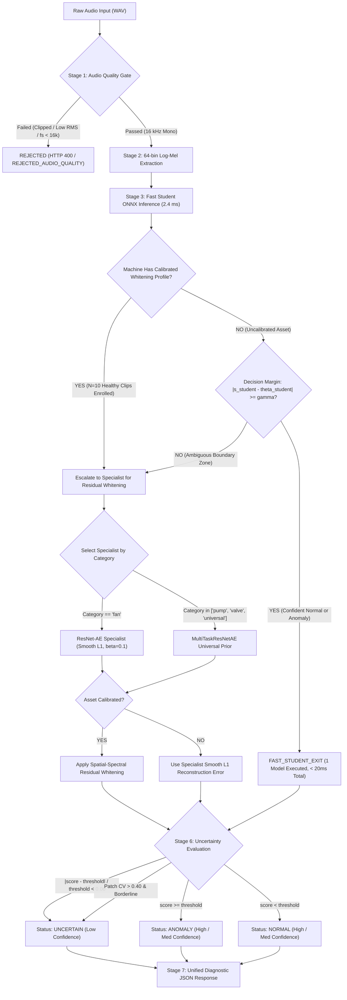

# Stetho Adaptive Model Routing & Decision Policy

**Document Reference:** POL-STETHO-8.1-ROUTING-001  
**Sprint / Phase:** Sprint 8.1 Unified Existing Model Inference Architecture  
**Status:** ACTIVE & ENFORCED  
**Branch:** `feature/field-data-readiness`  
**Governing Module:** [`ml/inference/routing.py`](file:///c:/Users/Atul2/OneDrive/Desktop/KiroHackethon/Sethoo/ml/inference/routing.py)  

---

## 1. Objective & Policy Rationale

Industrial acoustic anomaly detection requires balancing two conflicting operational objectives:
1. **Low Latency & High Throughput:** Continuous multi-sensor industrial monitoring requires edge-friendly, sub-50ms CPU execution to process thousands of continuous audio channels.
2. **High Precision & Low False Alarm Rate:** Industrial plant operators incur massive costs when false alarms trigger unnecessary machine teardowns or when catastrophic faults are missed.

A naive single-model architecture fails this tradeoff: ultra-compact models lack capacity for subtle, complex faults, while high-capacity residual ensembles incur excessive computational overhead on obvious normal sounds. Furthermore, physical machinery across different mechanical categories (fans, pumps, valves) possess fundamentally distinct acoustic physics.

The **Stetho Adaptive Routing Policy** dynamically orchestrates model execution based on:
- **Machine Category** (Fan aerodynamic blade noise vs. Pump fluid cavitation vs. Valve mechanical seat leakage).
- **Available Calibration Profile** (Zero-shot uncalibrated vs. Few-shot spatial-spectral residual whitened).
- **Audio Quality & Adverse Acoustic Environment** (Microphone clipping, low SNR, background hiss).
- **Score Uncertainty Margin** (Distance from the operating decision boundary).
- **Model Availability & Health** (Automatic fallback if a specialist checkpoint is unavailable).

---

## 2. Dynamic Routing Logic & Flowchart



---

## 3. Comprehensive Decision Factor Matrix

| Decision Factor | Evaluation Criteria | Routing Effect |
|---|---|---|
| **Audio Quality Gate** | Sample rate $< 16\text{ kHz}$, clipping $> 0.1\%$, RMS $< -60\text{ dBFS}$ | **Immediate Rejection:** Halts pipeline; returns `QUALITY_REJECTED` without executing neural inference. |
| **Adverse Noise Warning** | Spectral Flatness $> 0.12$ or High-Frequency Ratio $> -14\text{ dBFS}$ | Flags warning; widens uncertainty margin by $2\times$; caps confidence at `MEDIUM`. |
| **Machine Category** | Asset registered as `fan` | Selects `ResNet-AE` with 64-band spatial-temporal GroupNorm residual blocks. |
| **Machine Category** | Asset registered as `pump` or `valve` | Selects `MultiTaskResNetAE` universal multi-category acoustic prior. |
| **Calibration Status** | Calibrated with $N=10$ healthy clips | **Bypasses Student Fast-Exit:** Escalates directly to specialist to compute spatial-spectral whitened residuals. |
| **Decision Margin ($\Delta$)** | $|s_{\text{student}} - \theta_{\text{student}}| \ge 0.05$ | **Fast Student Exit:** Accepts student classification immediately; saves ~75% CPU latency. |
| **Decision Margin ($\Delta$)** | $|s_{\text{student}} - \theta_{\text{student}}| < 0.05$ | **Specialist Escalation:** Sample is ambiguous; routes to high-capacity specialist for deeper analysis. |
| **Score Proximity** | $\delta_{\text{rel}} = |s - \theta| / \theta < 0.06$ | **Uncertainty Trigger:** Score is within $\pm 6\%$ of threshold; forces `UNCERTAIN` classification. |
| **Patch Dispersion** | Coefficient of Variation $\sigma_{\text{patch}} / \mu_{\text{patch}} > 0.40$ | **Burst Anomaly Warning:** Signals intermittent or fluttering noise; triggers `UNCERTAIN` if near boundary. |

---

## 4. Category-Aware Specialist Selection Matrix

To prevent catastrophic out-of-domain errors caused by acoustic physics divergence between machine types:

| Registered Category | Primary Specialist Model | Checkpoint Origin | Scoring Objective | Rationale |
|---|---|---|---|---|
| **Industrial Fan (`fan`)** | `ResNet-AE Specialist` | `phase4/residual_cnn_ae/{machine_id}/model.pt` | Smooth L1 ($\beta=0.1$) | Optimally tuned to blade-pass frequencies (BPF) and casing aerodynamics. |
| **Centrifugal Pump (`pump`)** | `MultiTaskResNetAE` | `phase4/residual_cnn_ae/id_00/model.pt` | Multi-category Smooth L1 | Broad acoustic prior sensitive to low-frequency impeller cavitation and seal wear. |
| **Process Valve (`valve`)** | `MultiTaskResNetAE` | `phase4/residual_cnn_ae/id_00/model.pt` | Multi-category Smooth L1 | Captures transient high-frequency pneumatic chattering and seat leakage. |
| **Universal / Unspecified** | `MultiTaskResNetAE` | `phase4/residual_cnn_ae/id_00/model.pt` | Multi-category Smooth L1 | Conservative fallback preventing domain mismatch. |

---

## 5. Three-Zone Decision Policy & Uncertainty Quantification

Traditional binary classifiers force an uncalibrated model to declare `NORMAL` or `ANOMALY` even when a sample lands directly on the boundary. Stetho formally establishes a **three-zone decision policy**:

```
[ Score: 0.00 ] ------------ [ Normal-Like ] ------------ [ 0.94 * Theta ] === [ UNCERTAIN ZONE ] === [ 1.06 * Theta ] ------------ [ Anomalous ] ------------>
                                                                                   ^
                                                                       Operating Threshold (Theta)
```

### 5.1 Zone Definitions
1. **NORMAL Zone ($s < 0.94 \times \theta$):**
   - Signal conforms unambiguously to healthy baseline.
   - Status: `NORMAL`.
   - Confidence: `HIGH` if $s \le 0.80 \times \theta$; `MEDIUM` if $0.80 < s / \theta \le 0.94$.
2. **UNCERTAIN Zone ($0.94 \times \theta \le s \le 1.06 \times \theta$):**
   - Signal resides within the boundary margin.
   - Status: **`UNCERTAIN`**.
   - Confidence: **`LOW`**.
   - Diagnostic Reason: `BORDERLINE_SCORE: Score X is within Y% of threshold Z`.
   - Action: Flagged for automated re-test or secondary physical vibration check.
3. **ANOMALY Zone ($s > 1.06 \times \theta$):**
   - Structural acoustic deviation detected.
   - Status: `ANOMALY`.
   - Confidence: `HIGH` if $s \ge 1.20 \times \theta$; `MEDIUM` if $1.06 < s / \theta \le 1.20$.

---

## 6. Strict Prohibitions & Scientific Guardrails

1. **NO Score Averaging Across Models:**
   - Averaging a raw Student L1 score ($\sim 1.76$) with a ResNet Smooth L1 score ($\sim 0.21$) or a Whitened Z-score ($\sim 0.88$) produces a mathematically meaningless number.
   - **Enforcement:** The unified engine outputs ONLY the continuous score of the primary decisive model, with its matching threshold and route metadata.
2. **NO Calibrated Probability Claims:**
   - Reconstruction error is a distance metric in Log-Mel representation space, NOT a Bayesian posterior probability.
   - **Enforcement:** The engine outputs discrete confidence levels (`HIGH`, `MEDIUM`, `LOW`) derived from threshold distance and quality metrics. It never reports "98.4% probability of failure".
3. **NO Uncalibrated Category Cross-Over:**
   - Fan specialist models must never be applied to pumps or valves without the multi-task prior or explicit cross-category logging.
   - **Enforcement:** The router strictly enforces category compatibility checks, rejecting unauthorized cross-category evaluations.
