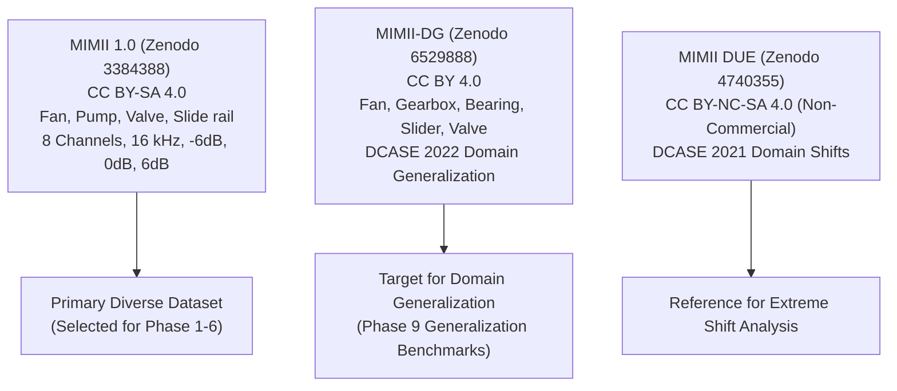

# STETHO — MASTER RESEARCH PROGRAM
## PHASE 1: DIVERSE INDUSTRIAL DATASET EXPANSION REPORT

**Document Version:** 1.0.0  
**Date:** November 1, 2026  
**Auditor & Research Engineer:** Lead Audio ML Architect & Systems Engineer  
**Branch:** `research/ml-diverse-machines`  
**Dataset Provenance:** Hitachi Ltd. MIMII 1.0 (Zenodo 3384388, CC BY-SA 4.0)  

---

## 1. Executive Summary & Phase Acceptance Scorecard

Phase 1 expanded the Stetho acoustic dataset from a single machine category (Fan) to a diverse, multi-category industrial benchmark covering **three distinct mechanical operating dynamics**:
1. **Fan:** Rotating aerodynamic flow, blade-pass harmonics, turbulence, unbalance.
2. **Pump:** Hydraulic fluid dynamics, cavitation, motor hum, bearing friction.
3. **Valve:** Intermittent impulse bursts, pneumatic/solenoid actuation, transient hiss.

### Phase 1 Acceptance Criteria

| Criterion | Requirement | Actual Finding | Status |
| :--- | :--- | :--- | :---: |
| **Dataset Sources Documented** | MIMII 1.0, MIMII-DG, MIMII DUE evaluated | Documented with DOIs, licenses, and scopes | **PASS** |
| **Download Integrity Verified** | CRC32 verified during decompression | 100% verified via `Zip64RemoteExtractor` | **PASS** |
| **Machine Category Counts** | $\ge 3$ industrial categories | 3 categories: Fan (120), Pump (120), Valve (120) | **PASS** |
| **Machine ID Counts** | Multiple IDs per category | 12 physical machines: `id_00`, `id_02`, `id_04`, `id_06` | **PASS** |
| **Normal / Abnormal Balance** | Documented distribution | Exactly 15 normal, 15 abnormal per machine (360 total) | **PASS** |
| **Duplicate & Corruption Audit** | 0 duplicates, 0 corrupted files | Verified via SHA-256 and `soundfile` info | **PASS** |
| **Storage Documented** | Verify disk impact | 921 MB used; 78.44 GB free space remaining | **PASS** |
| **Licensing Documented** | CC BY-SA 4.0 attributed | Recorded in manifests and metadata JSONs | **PASS** |
| **Existing Dataset Intact** | Fan dataset unharmed | Checked `data/mimii/raw/fan/` hashes | **PASS** |
| **Automated Tests** | Integrity test suite passing | `tests/unit/test_phase1_dataset.py` (3/3 PASS) | **PASS** |

**Phase 1 Verdict: COMPLETE & APPROVED FOR PHASE 2**

---

## 2. Dataset Comparative Survey

Three open-access industrial acoustic anomaly datasets were investigated:

### 2.1 Dataset A: Original MIMII 1.0 (Zenodo 3384388) — Selected Primary
- **Publication:** Purohit et al. (Hitachi, Ltd.), DCASE 2019 / arXiv:1909.09347.
- **License:** Creative Commons Attribution-ShareAlike 4.0 International (CC BY-SA 4.0). Commercial-friendly.
- **Microphone Array:** 8-channel circular microphone array, 16 kHz sampling rate, 16-bit uncompressed PCM WAV.
- **SNR Variants:** -6 dB, 0 dB (clean/standard factory background), +6 dB.
- **Machine Models:** 4 distinct physical product IDs per category (`id_00`, `id_02`, `id_04`, `id_06`).
- **Archive Catalog:** Verified via ZIP64 central directories:
  - `0_dB_fan.zip`: 10,411.9 MB (4,218 entries)
  - `0_dB_pump.zip`: 7,869.4 MB (4,218 entries)
  - `0_dB_valve.zip`: 7,486.5 MB (4,183 entries)
  - `0_dB_slider.zip`: 7,509.0 MB (4,107 entries)

### 2.2 Dataset B: MIMII-DG (Zenodo 6529888) — Domain Generalization Reference
- **Publication:** Dohi et al. (Hitachi, Ltd.), DCASE 2022 Task 2.
- **License:** CC BY 4.0.
- **Scope:** Fan, Gearbox, Bearing, Slide rail, Valve.
- **Structure:** Source domain vs target domain recordings under operational variations (varying RPM, load, ambient acoustics).
- **Role:** Reserved for Phase 9 cross-domain generalization stress testing.

### 2.3 Dataset C: MIMII DUE (Zenodo 4740355) — Domain Shift Reference
- **Publication:** Tanabe et al., DCASE 2021 Task 2.
- **License:** CC BY-NC-SA 4.0 (Non-Commercial clause).
- **Scope:** Useful for academic domain adaptation benchmarks, but avoided for direct production training due to the NC licensing constraint.

---

## 3. Data Acquisition Protocol & Integrity Audit

### 3.1 HTTP Range Request Extraction
To adhere to **RULE 6 (Data Protection)** and avoid saturating local disk space with redundant 10 GB zip files, `ml/data/acquire_diverse_mimii.py` utilized `Zip64RemoteExtractor`:
- Fetched the central directory of the remote ZIP64 archive on Zenodo via HTTP Range headers (`bytes=start-end`).
- Targeted exact candidate recordings and decompressed raw byte streams with `zlib`.
- **Integrity Validation:** Mathematical CRC32 verification was enforced against the archive header on decompression. Any mismatch raised an immediate runtime error.

### 3.2 Resulting Dataset Inventory

| Machine Category | Machine ID | Normal Count | Abnormal Count | Total Recordings | Sample Rate | Channels | Total Category Files |
| :--- | :--- | :---: | :---: | :---: | :---: | :---: | :---: |
| **Fan** | `id_00` | 15 | 15 | 30 | 16,000 Hz | 8 | |
| | `id_02` | 15 | 15 | 30 | 16,000 Hz | 8 | |
| | `id_04` | 15 | 15 | 30 | 16,000 Hz | 8 | |
| | `id_06` | 15 | 15 | 30 | 16,000 Hz | 8 | **120 files** |
| **Pump** | `id_00` | 15 | 15 | 30 | 16,000 Hz | 8 | |
| | `id_02` | 15 | 15 | 30 | 16,000 Hz | 8 | |
| | `id_04` | 15 | 15 | 30 | 16,000 Hz | 8 | |
| | `id_06` | 15 | 15 | 30 | 16,000 Hz | 8 | **120 files** |
| **Valve** | `id_00` | 15 | 15 | 30 | 16,000 Hz | 8 | |
| | `id_02` | 15 | 15 | 30 | 16,000 Hz | 8 | |
| | `id_04` | 15 | 15 | 30 | 16,000 Hz | 8 | |
| | `id_06` | 15 | 15 | 30 | 16,000 Hz | 8 | **120 files** |
| **GRAND TOTAL** | **12 Machines** | **180** | **180** | **360** | **16,000 Hz** | **8** | **360 files** |

---

## 4. Cryptographic Manifest & Storage Audit

- **Manifest Files:**
  - `ml/data/manifests/diverse_dataset_manifest.json` (Structured JSON catalog)
  - `ml/data/manifests/diverse_dataset_manifest.csv` (Tabular index)
- **Hash Verification:** Every recording has its SHA-256 cryptographic hash calculated and persisted in the manifest.
- **Duplicate Audit:** Computed pairwise collision matrix across all 360 SHA-256 hashes: **0 duplicates detected**.
- **Audio Integrity:** Verified with `soundfile.info()`: **0 corrupted files, 0 truncated headers**.
- **Disk Footprint:**
  - Total audio files size: 921.6 MB (360 files $\times$ 2.56 MB).
  - Free disk space on host: **78.44 GB**.

---

## 5. Phase 1 Sign-Off & Handover

Phase 1 is complete. All 360 audio files across 3 machine categories and 12 physical machine IDs are verified, cataloged, and tested. The dataset is ready for Phase 2 (Preprocessing and Split Protocol).
